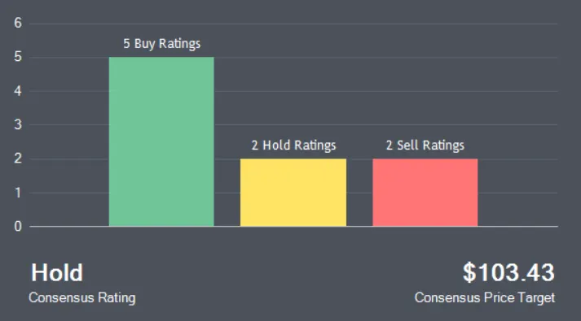
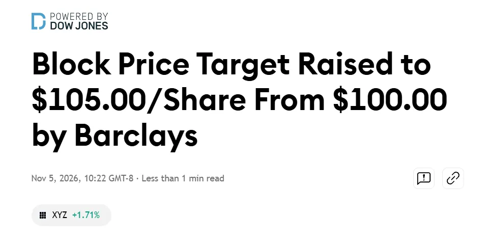
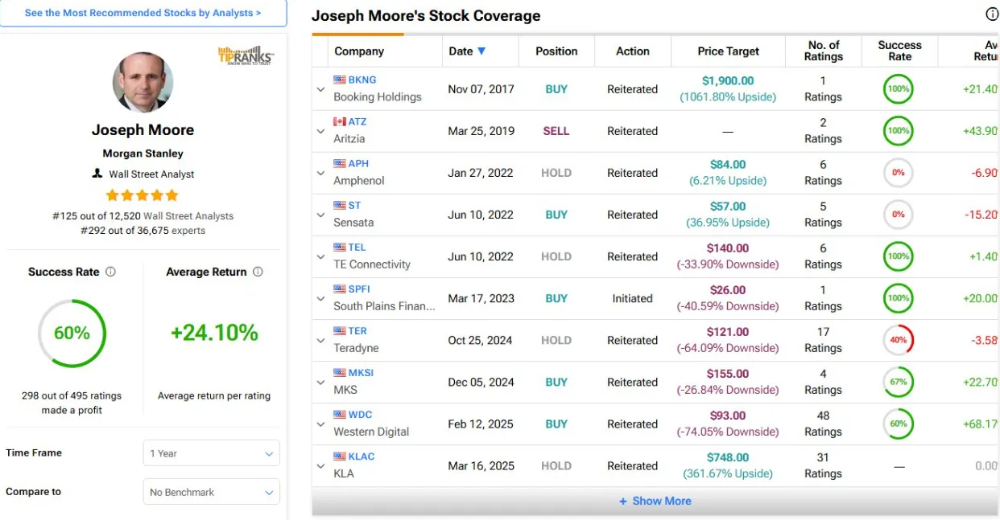

Hey investor!

Welcome back to the Vassant Substack.

Today we're discussing analysts, and why you should take their recommendations with a grain of salt.

**Let's dive in!**

---

When a new investor begins their journey, they are overwhelmed with information.

Sometimes, this information can be too hard to handle all at once.

Hell, I certainly wasn't the best at digesting it all.

So what's the natural remedy?

{/* truncate */}

**Get someone else's opinion.**

Nowadays, these sources of credibility can come from many places:

1. Social Media Influencers
2. Friends and Family
3. Accredited Analysts

The last one is the one I am particularly interested in for this piece.

I'll spend a bit of time breaking down who they are, what they do, and maybe why you should take their word with a grain of salt.

## Table of Contents

1. What Do Analysts Do?
2. Trading Fees
3. Business Deals
4. Analyst Ratings

## 1. What Do Analysts Do?

Analysts, in general, perform research on investable assets for other entities or individuals for the purpose of providing an official recommendation on that asset.

Generally, their research is intended to find assets that can help the firm or its clients **outperform the market**.

This research can take many forms.

It can involve browsing recent events, fundamental analysis, management assessment, calls with insiders or industry experts, and customer fieldwork.

Everything comes together in that final recommendation to buy, hold, sell, or ignore that asset.

*Source: MarketBeat*

To supplement the report, fundamental and quantitative analysis come together in a detailed financial model, often in Excel ([Source: Investopedia](https://www.investopedia.com/)).

The model outlines current performance, expected future performance, and how all of that is reflected in the current price.

The analyst attempts to assign a fair value to the stock using future assumptions generated from the research already completed.

**Fair value** is used as an anchor to measure the percentage difference from the price target offered by the analyst.

Analysts also typically have a specialization on which they focus, allowing them to become experts in a particular area. Some examples include hyperscalers, medical devices, ecommerce, or retail.

But before going into more detail, I should make a clarification.

There are **TWO** types of analysts:

1. **"Buy-Side"** analysts
2. **"Sell-Side"** analysts

**Buy-side analysts** operate within an internal team.

They typically work for entities that manage money, such as a hedge fund or a mutual fund ([Source: Financial Edge](https://www.fe.training/)).

They perform market research on investable securities and report back to their team or portfolio manager with an official report and recommendation.

Portfolio managers and analysts work closely together to decide how to incorporate a security, if at all, into their portfolio.

**Sell-side analysts**, on the other hand, are more public-facing.

> Note: For this article, I will be exclusively focusing on sell-side analysts because they impact us, as individual investors, the most.

They follow a similar research process, but their reports are intended for clients and other parties outside their firm rather than an internal investment team.

Recommendations are distributed to these private clients via restricted channels such as Bloomberg or FactSet.

Clients are the first to receive the information and get the first opportunity to act on the news.

However, these reports (or more often, just the headline recommendations) can become public through media outlets such as TipRanks or MarketWatch.

This is how you eventually find news articles with headlines like this:

*Source: TradingView*

From the client's perspective, if you think about it, this is actually kind of desirable.

If a detailed (bullish) report is published on a stock, and the client receives this report and purchases large blocks of shares, they have an incentive to make a profit.

So these sell-side firms ensure the reports are distributed to media outlets ***AFTER*** clients receive them.

Algorithmic trading on the new information frequently reprices the stock in favor of the client.

Kinda a twisted system, huh?

The crazy part is, that's not all.

Sell-side analyst reports serve a purpose other than telling clients what to buy.

Interestingly, when the report is sent to clients and a client chooses to purchase a $50 million block of shares, Wall Street etiquette dictates that they **route the order through the trading desk of the bank that wrote the report**.

As you can already imagine, this sparks some interesting conflicts of interest.

And the best part yet, this isn't the only one.

This is exactly what I'll talk more about in the next section.

## 2. Trading Fees

Let's revisit the last portion of the previous section.

> Interestingly, when the report is sent to clients and a client chooses to purchase a $50 million block of shares, Wall Street etiquette dictates that they route the order through the trading desk of the bank that wrote the report.

Wall Street etiquette is really interesting here, because clients don't actually pay these firms for the research report.

The clients reward the firms instead by making a purchase, if the report is convincing enough, that is routed through the analyst's firm. This earns that firm exorbitant amounts of cash through trading fees (commissions).

So compensation is directly tied to action after reading the report.

**The obvious incentive misalignment:**

> If a client generates revenue for the firm by acting on the report they receive, the firm is incentivized to curate the report in a way that could be misleadingly bullish or bearish.

But what does the analyst have to gain? That's just their job?

Well, here's the kicker:

**Analysts earn bonuses on top of their annual base pay, and those bonuses can be dependent on client trading activity**, among other things that we'll touch on soon ([Source: Financial Edge](https://www.fe.training/)).

So now our suspicion is real: sell-side analysts may be incentivized to **NOT** be objective in their analysis for personal gain.

An example: If an analyst upgrades a stock from "Hold" to "Buy," a hedge fund client reading the bullish report might think, "Great point, I want to buy 500,000 shares."

Naturally, the analyst thinks, "If I word this the right way and convince the client to buy, I make a fortune!"

***The report must spark action.***

It probably means the report is impacted by a combination of things:

- Downplaying important bear points
- Seeking out biased sources
- Unjustifiably high stock target prices

All of these biases can make their way into the final stock price target and the official buy/hold/sell recommendation.

## 3. Business Deals

Commissions on trades are only one piece of the pie.

Another lucrative cash flow stream is from fees earned on business deals.

But what kinds of business deals?

Some examples are M&A and IPOs.

Within a sell-side firm, there are several departments:

- One is the **Research Division**, which includes our favorite sell-side analyst.
- Another is the **Investment Banking Division**, which includes investment bankers who help execute M&A and IPOs.

Legally, these divisions must be strictly segregated within an organization.

But still, both have strategic roles in a single workflow.

Here's the typical process:

1. A research analyst (let's call him Jake) publishes an in-depth report on a public stock. Let's say this report is very bullish.

2. A CEO of a firm independently wants to take their business public.

3. The CEO, wanting to do everything in their power to positively impact the stock price of their organization, decides to seek out investment banks to help carry out the IPO deal. They are likely to favor a bank whose analysts have a history of writing positive stock analysis reports.

4. The CEO chooses the investment bank that employs Jake because of how consistently Jake writes positive reports, understanding that he may offer similarly favorable coverage once the company is public.

5. The IPO deal is carried out by the independent Investment Banking Division of Jake's company.

6. Jake's company earns a hefty profit from the transaction.

*Source: vibe.us*

So how does Jake profit?

Regulations say Jake, as a research analyst, cannot be directly compensated for business deals as an analyst:

> Under FINRA Rule 2241(b)(2)(E), member firms must maintain written policies and procedures that prohibit analyst compensation based upon specific investment banking services transactions. ([Source: FINRA](https://www.finra.org/rules-guidance/rulebooks/finra-rules/2241))

Interestingly, research analysts can also be paid through profit-sharing from the total firm's profits.

So when the firm earns $50 million from an IPO, **the analyst may indirectly receive a portion of the cut at the end of the year**.

And let's go back to the CEO of the now-public firm.

Here's why he chose Jake's firm:

Once the mandatory regulatory "quiet period" ends (typically 25 days post-IPO), the analyst publishes their Initiation of Coverage report.

This report is **much more likely to be positive given the firm's reputation for favorable coverage**, potentially leading to higher stock prices once the report comes out and making shareholders more money in the process.

This positively skewed bias also makes its way into higher stock price targets and buy recommendations, which may be inflated relative to what the business should return over the short term.

To illustrate this, here's an excerpt from a study from Cornell University on underwriting analysts (analysts who work at the firm underwriting a business deal) versus non-underwriting analysts (independent analysts):

> "The study also showed that stock prices of IPO companies recommended by underwriting analysts dropped on average, while those recommended by non-underwriting analysts rose during the Securities and Exchange Commission 'quiet period,' 30 days before analysts issue recommendations on an IPO, and that lead **underwriter analysts** made 50 percent more 'buy' recommendations on the IPO stock underwritten by their bank than did **non-underwriting analysts**."
>
> *Source: Cornell Chronicle, 2000*

In other words, analysts who work at firms that underwrite an IPO may be positively biased.

This does not translate to higher stock price returns.

In fact, this data shows us quite the opposite.

## 4. Analyst Ratings

Here's another weird dynamic that I hadn't known about in my early investing career.

Analysts are ***rated.***

And there are actually two ranking systems:

1. Public rankings (objective)
2. Private, Institutional Investor rankings

The first type can be found by any individual investor on a platform like TipRanks:

*Source: WallStreet Survivor*

TipRanks rankings are objective rankings based on fundamental data and performance history:

- Success rate
- Profits per trade
- Consistency

These rankings are generally consumer-facing and are generated by outside third parties.

I will focus less on this because analysts are not compensated more just because they rank highly on TipRanks.

The second type of ranking, the institutional investor ranking, is much more relevant here.

Portfolio managers and hedge fund analysts are the ones voting on these sell-side analysts.

The ranking is based on the following factors:

- How intricate the analyst's research is
- Specific industry insights not generally shared or known by the public
- Corporate access to CEOs or VPs of companies

**That last point is particularly interesting to me.**

An analyst can be rated highly by having the ability to offer funds direct lines of communication to corporate management to ask them questions about their business.

The analyst isn't even being rated on their work!

Relationships really do get you a long way, huh?

Jokes aside, rankings from these clients play a big role in analyst compensation.

Pay is directly linked to the institutional commission pool allocation.

Banks pay their star analysts so much because they are respected and highly valued by the people who line the banks' pockets.

At the end of the year, those highly rated analysts are given a nice bonus to prevent them from quitting and moving to a competitor bank.

Because that would likely mean a direct loss in trading revenue.

> **The cost of the analyst's bonus is much cheaper than the cost of losing that revenue without them.**

Bringing this all together, what this tells us is that analysts are further incentivized to please corporate managers.

How does this manifest?

Surprise, surprise: through favorable coverage!

It's all one big twisted loop, eh?

## Bringing it All Together

We've learned so far that analyst ratings are not as benign or objective as they're made out to be.

The ones submitting these recommendations might appear as "lazy stock pickers" on the surface, but behind closed doors, they are respected employees who can receive ridiculously large bonuses at the end of the year.

And the ones that suffer?

Individual investors.

They only see the end recommendation, not all the confounding variables leading up to that exact number or recommendation.

So what can we do to take back control?

Ignore the noise.

Yes, it's that simple.

When you see a stock rocket up 5–10% because of a new analyst rating, just know that there's nothing you can do to control the situation, and the rating may not deserve the weight the market gives it.

**Just focus on fundamental analysis, conviction, and discipline. Those are the things that can support better long-term investment decisions.**

For more information on institutional incentives, check out Vassant's Discover Content on the web application or mobile platform.
